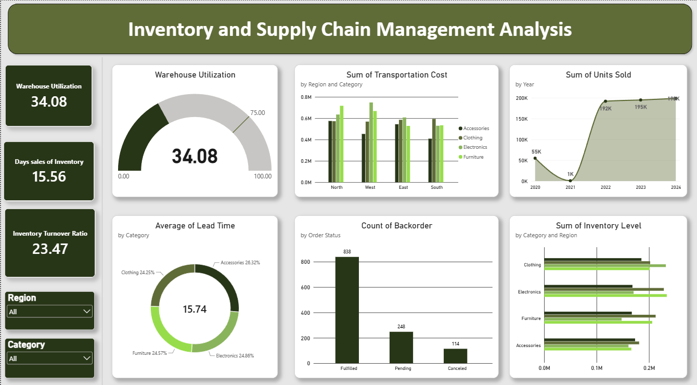

# Inventory-Supply_Chain_Analysis

In this project, I will aim to analyze 3 important metrics of running a business—specifically when selling to customers. The metrics looked at are the warehouse utilization rate, days sales of inventory, and inventory turnover rate. To maximize profit, it is important to look at inefficiencies in these areas and recommend actionable improvements.

Warehouse Utilization - Warehouse space being used.

Days sales of inventory - Amount of days it takes to sell inventory.

Inventory turnover rate - How often the inventory is sold or replaced.

